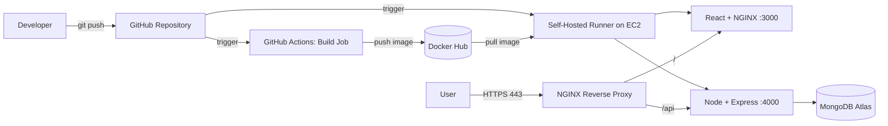

<div align="center">

# MERN Stack Deployment on AWS EC2

**Production-style CI/CD pipeline for a full stack MERN application using Docker, GitHub Actions, NGINX and Let's Encrypt SSL.**


[](LICENSE)

[Overview](#overview) · [Architecture](#architecture) · [Getting Started](#getting-started) · [CI/CD](#cicd-pipeline) · [Troubleshooting](#troubleshooting) · [Author](#author)

</div>

---

## Table of Contents

- [Overview](#overview)
- [Architecture](#architecture)
- [Tech Stack](#tech-stack)
- [Prerequisites](#prerequisites)
- [Getting Started](#getting-started)
  - [1. MongoDB Atlas](#1-mongodb-atlas)
  - [2. AWS EC2](#2-aws-ec2)
  - [3. Docker Installation](#3-docker-installation)
  - [4. Dockerize the Applications](#4-dockerize-the-applications)
  - [5. GitHub Secrets](#5-github-secrets)
  - [6. Self-Hosted Runners](#6-self-hosted-runners)
- [CI/CD Pipeline](#cicd-pipeline)
- [Domain, NGINX and SSL](#domain-nginx-and-ssl)
- [Troubleshooting](#troubleshooting)
- [Production Hardening](#production-hardening)
- [Summary](#summary)
- [Contributing](#contributing)
- [License](#license)
- [Author](#author)

---

## Overview

This repository documents the complete deployment of a MERN (MongoDB, Express, React, Node.js) application on a single AWS EC2 Ubuntu instance. Each application runs in its own isolated Docker container, and every push to the main branch triggers an automated build and deploy.

| Application | Technology                  | Container Port                |
|-------------|-----------------------------|-------------------------------|
| Backend API | Node.js, Express, MongoDB   | `4000`                        |
| Frontend    | React served by NGINX       | `3000` (mapped to `80` inside the container) |

### Deployment Flow

1. A commit is pushed to GitHub.
2. GitHub Actions builds a Docker image on a GitHub-hosted runner.
3. The image is pushed to Docker Hub.
4. A self-hosted runner on EC2 pulls the image.
5. The previous container is removed and the new one is started.
6. NGINX and Certbot serve the application over HTTPS on a custom domain.

---

## Architecture



Separating the frontend and backend into dedicated containers keeps the deployment modular and allows each service to be updated independently.

---

## Tech Stack

| Layer            | Technology                     |
|------------------|--------------------------------|
| Database         | MongoDB Atlas (free tier)      |
| Backend          | Node.js, Express               |
| Frontend         | React                          |
| Containerization | Docker (`node:alpine`, `nginx:alpine`) |
| Cloud            | AWS EC2 (Ubuntu)               |
| CI/CD            | GitHub Actions, Docker Hub     |
| Reverse Proxy    | NGINX                          |
| SSL              | Certbot, Let's Encrypt         |

---

## Prerequisites

- AWS account (free tier is sufficient)
- GitHub account with two repositories (backend and frontend)
- Docker Hub account
- MongoDB Atlas account
- A registered domain name
- Working knowledge of Linux, Git and Docker

---

## Getting Started

### 1. MongoDB Atlas

1. Create a project and a cluster (free tier, AWS provider).
2. Under **Database Access**, create a database user.
3. Under **Network Access**, add an IP address:
   - Testing: `0.0.0.0/0`
   - Production: the EC2 Elastic IP only
4. Open **Connect > Drivers** and copy the connection string:

```text
mongodb+srv://<username>:<password>@cluster0.xxxxx.mongodb.net/<dbname>?retryWrites=true&w=majority
```

> **Note:** Never commit this URI to the repository. Store it as a GitHub Secret.

### 2. AWS EC2

Launch an Ubuntu instance (`t2.micro` or `t3.micro`), create an SSH key pair, and configure the security group:

| Type   | Port | Source      | Purpose                           |
|--------|------|-------------|-----------------------------------|
| SSH    | 22   | Your IP     | Server access                     |
| HTTP   | 80   | 0.0.0.0/0   | Web traffic and Certbot validation|
| HTTPS  | 443  | 0.0.0.0/0   | Secure web traffic                |
| Custom | 3000 | 0.0.0.0/0   | Frontend container (testing only) |
| Custom | 4000 | 0.0.0.0/0   | Backend container (testing only)  |

Connect to the instance:

```bash
chmod 400 your-key.pem
ssh -i your-key.pem ubuntu@<EC2_PUBLIC_IP>
```

### 3. Docker Installation

Docker is not pre-installed on EC2.

```bash
sudo apt-get update
sudo apt-get install -y docker.io

sudo systemctl start docker
sudo systemctl enable docker

sudo usermod -aG docker $USER
newgrp docker

docker version
docker ps
```

### 4. Dockerize the Applications

**Backend `Dockerfile`**

```dockerfile
FROM node:alpine

WORKDIR /app

COPY package*.json ./
RUN npm install

COPY . .

EXPOSE 4000

CMD ["npm", "run", "start"]
```

**Frontend `Dockerfile` (multi-stage)**

```dockerfile
# Stage 1: Build
FROM node:alpine AS build

WORKDIR /app

COPY package*.json ./
RUN npm install

COPY . .

ARG REACT_APP_BASE_URL
ENV REACT_APP_BASE_URL=$REACT_APP_BASE_URL

RUN npm run build

# Stage 2: Serve
FROM nginx:alpine

COPY --from=build /app/build /usr/share/nginx/html

EXPOSE 80

CMD ["nginx", "-g", "daemon off;"]
```

> **Note:** For Vite projects, the output directory is `dist` and the variable prefix is `VITE_`.

**Backend MongoDB connection**

```js
const mongoose = require("mongoose");

mongoose
  .connect(process.env.MONGODB_URI)
  .then(() => console.log("MongoDB connected"))
  .catch((err) => console.error("MongoDB connection error:", err));
```

### 5. GitHub Secrets

Navigate to **Settings > Secrets and variables > Actions** in each repository.

**Backend repository**

| Secret            | Description                          |
|-------------------|--------------------------------------|
| `DOCKER_USERNAME` | Docker Hub username                  |
| `DOCKER_PASSWORD` | Docker Hub access token              |
| `MONGODB_URI`     | MongoDB Atlas connection string      |

**Frontend repository**

| Secret               | Description                                   |
|----------------------|-----------------------------------------------|
| `DOCKER_USERNAME`    | Docker Hub username                           |
| `DOCKER_PASSWORD`    | Docker Hub access token                       |
| `REACT_APP_BASE_URL` | Backend base URL, e.g. `https://app.example.com/api` |

### 6. Self-Hosted Runners

Create one runner per repository, each in its own directory on the EC2 instance.

```bash
mkdir ~/actions-runner-backend && cd ~/actions-runner-backend
# Run the download and ./config.sh commands from GitHub:
# Settings > Actions > Runners > New self-hosted runner

mkdir ~/actions-runner-frontend && cd ~/actions-runner-frontend
# Repeat for the frontend repository
```

Install each runner as a service so it survives terminal disconnects:

```bash
sudo ./svc.sh install
sudo ./svc.sh start
sudo ./svc.sh status
```

---

## CI/CD Pipeline

Both repositories use a two-job pipeline.

| Job      | Runner                          | Responsibility                                      |
|----------|---------------------------------|-----------------------------------------------------|
| `build`  | GitHub-hosted (`ubuntu-latest`) | Docker login, image build, push to Docker Hub       |
| `deploy` | Self-hosted (EC2)               | Pull image, remove old container, start new one     |

### Backend: `.github/workflows/deploy.yml`

```yaml
name: Deploy Backend

on:
  push:
    branches: [main]

jobs:
  build:
    runs-on: ubuntu-latest
    steps:
      - name: Checkout
        uses: actions/checkout@v4

      - name: Docker Hub login
        run: echo "${{ secrets.DOCKER_PASSWORD }}" | docker login -u "${{ secrets.DOCKER_USERNAME }}" --password-stdin

      - name: Build image
        run: docker build -t ${{ secrets.DOCKER_USERNAME }}/mern-backend:latest .

      - name: Push image
        run: docker push ${{ secrets.DOCKER_USERNAME }}/mern-backend:latest

  deploy:
    needs: build
    runs-on: self-hosted
    steps:
      - name: Pull latest image
        run: docker pull ${{ secrets.DOCKER_USERNAME }}/mern-backend:latest

      - name: Remove old container
        run: docker rm -f mern-backend || true

      - name: Run new container
        run: |
          docker run -d \
            --name mern-backend \
            --restart unless-stopped \
            -p 4000:4000 \
            -e MONGODB_URI="${{ secrets.MONGODB_URI }}" \
            ${{ secrets.DOCKER_USERNAME }}/mern-backend:latest
```

### Frontend: `.github/workflows/deploy.yml`

```yaml
name: Deploy Frontend

on:
  push:
    branches: [main]

jobs:
  build:
    runs-on: ubuntu-latest
    steps:
      - name: Checkout
        uses: actions/checkout@v4

      - name: Docker Hub login
        run: echo "${{ secrets.DOCKER_PASSWORD }}" | docker login -u "${{ secrets.DOCKER_USERNAME }}" --password-stdin

      - name: Build image
        run: |
          docker build \
            --build-arg REACT_APP_BASE_URL="${{ secrets.REACT_APP_BASE_URL }}" \
            -t ${{ secrets.DOCKER_USERNAME }}/mern-frontend:latest .

      - name: Push image
        run: docker push ${{ secrets.DOCKER_USERNAME }}/mern-frontend:latest

  deploy:
    needs: build
    runs-on: self-hosted
    steps:
      - name: Pull latest image
        run: docker pull ${{ secrets.DOCKER_USERNAME }}/mern-frontend:latest

      - name: Remove old container
        run: docker rm -f mern-frontend || true

      - name: Run new container
        run: |
          docker run -d \
            --name mern-frontend \
            --restart unless-stopped \
            -p 3000:80 \
            ${{ secrets.DOCKER_USERNAME }}/mern-frontend:latest
```

> **Note:** React environment variables are embedded at build time, so they are passed as `--build-arg` rather than runtime `-e` flags.

After a successful run, verify on the EC2 instance:

```bash
docker ps
```

---

## Domain, NGINX and SSL

### DNS

Create an **A record** at your domain registrar:

| Type | Name  | Value             | TTL |
|------|-------|-------------------|-----|
| A    | `app` | `<EC2_PUBLIC_IP>` | 600 |

```bash
nslookup app.example.com
```

> **Tip:** Attach an Elastic IP to the instance so the address does not change on restart.

### NGINX Reverse Proxy

```bash
sudo apt-get install -y nginx
sudo nano /etc/nginx/sites-available/app.example.com
```

```nginx
server {
    listen 80;
    server_name app.example.com;

    location /api {
        proxy_pass http://localhost:4000;
        proxy_http_version 1.1;
        proxy_set_header Upgrade $http_upgrade;
        proxy_set_header Connection 'upgrade';
        proxy_set_header Host $host;
        proxy_set_header X-Real-IP $remote_addr;
        proxy_set_header X-Forwarded-For $proxy_add_x_forwarded_for;
        proxy_set_header X-Forwarded-Proto $scheme;
        proxy_cache_bypass $http_upgrade;
    }

    location / {
        proxy_pass http://localhost:3000;
        proxy_http_version 1.1;
        proxy_set_header Upgrade $http_upgrade;
        proxy_set_header Connection 'upgrade';
        proxy_set_header Host $host;
        proxy_set_header X-Real-IP $remote_addr;
        proxy_set_header X-Forwarded-For $proxy_add_x_forwarded_for;
        proxy_set_header X-Forwarded-Proto $scheme;
        proxy_cache_bypass $http_upgrade;
    }
}
```

```bash
sudo ln -s /etc/nginx/sites-available/app.example.com /etc/nginx/sites-enabled/
sudo nginx -t
sudo systemctl reload nginx
```

### SSL with Certbot

```bash
sudo apt-get install -y certbot python3-certbot-nginx
sudo certbot --nginx -d app.example.com
```

Certbot issues the certificate, updates the NGINX configuration for HTTPS, and offers an HTTP to HTTPS redirect. Verify automatic renewal:

```bash
sudo certbot renew --dry-run
```

---

## Troubleshooting

| Problem                              | Likely Cause                               | Resolution                                                  |
|--------------------------------------|--------------------------------------------|-------------------------------------------------------------|
| Backend cannot connect to MongoDB    | Incorrect URI or IP not whitelisted        | Verify the `MONGODB_URI` secret and Atlas Network Access    |
| Runner shows offline                 | Runner service stopped                     | `sudo ./svc.sh stop && sudo ./svc.sh start`                 |
| `container name already in use`      | Old container not removed                  | `docker rm -f <name> \|\| true` before `docker run`         |
| `port is already allocated`          | Old container still bound to the port      | Stop and remove the old container                           |
| `permission denied` on Docker socket | User not in the `docker` group             | `sudo usermod -aG docker $USER`, then restart the runner    |
| Certbot fails                        | DNS not propagated or port 80 blocked      | Check `nslookup` and the security group                     |
| Frontend calls the wrong API URL     | Build argument missing                     | Verify `REACT_APP_BASE_URL` and rebuild                     |
| `502 Bad Gateway`                    | Container not running                      | Check `docker ps` and `docker logs <name>`                  |

Useful commands:

```bash
docker ps -a
docker logs -f mern-backend
docker images
sudo nginx -t
sudo systemctl status nginx
```

---

## Production Hardening

This setup suits portfolio projects, demos and small client deployments. For larger production workloads, consider the following:

- [ ] Restrict the MongoDB Atlas IP allowlist to the EC2 IP
- [ ] Close ports `3000` and `4000`; expose only `80` and `443`
- [ ] Bind containers to localhost (`-p 127.0.0.1:4000:4000`)
- [ ] Move secrets to AWS Secrets Manager or a vault
- [ ] Tag images with the commit SHA for reliable rollbacks
- [ ] Add monitoring and centralized logging (CloudWatch, Grafana)
- [ ] Configure database backups
- [ ] Implement zero-downtime deployments (blue-green, or Docker Compose with health checks)
- [ ] Add an Elastic IP, and a load balancer with multiple instances for redundancy
- [ ] Restrict SSH access to a known IP

---

## Summary

| Component        | Description                      | Port(s)   | Key Configuration                  |
|------------------|----------------------------------|-----------|------------------------------------|
| AWS EC2          | Ubuntu host for all containers   | N/A       | Docker, self-hosted runners        |
| MongoDB Atlas    | Managed cloud database           | 27017     | URI stored in GitHub Secrets       |
| Node Backend     | Express API container            | 4000      | `node:alpine`                      |
| React Frontend   | Static build served by NGINX     | 3000 > 80 | Multi-stage Docker build           |
| GitHub Actions   | CI/CD pipeline                   | N/A       | Build, push, deploy                |
| Docker Hub       | Image registry                   | N/A       | Access token in secrets            |
| NGINX (host)     | Reverse proxy                    | 80 / 443  | `/api` to 4000, `/` to 3000        |
| Certbot          | Free SSL certificates            | 443       | Automatic renewal                  |

---

## Contributing

Contributions, issues and feature requests are welcome.

1. Fork the repository
2. Create a feature branch (`git checkout -b feature/improvement`)
3. Commit your changes (`git commit -m "Add improvement"`)
4. Push to the branch (`git push origin feature/improvement`)
5. Open a Pull Request

---

## License

Distributed under the MIT License. See [LICENSE](LICENSE) for more information.

---

## Author

**Talha Iqbal**
A Developer

[](https://github.com/ItsTalhaIqbal)
[](https://linkedin.com/in/itstalha-iqbal)
[](https://talha-iqbal.vercel.app)

<div align="center">

If this guide helped you, consider giving the repository a star.

</div>
